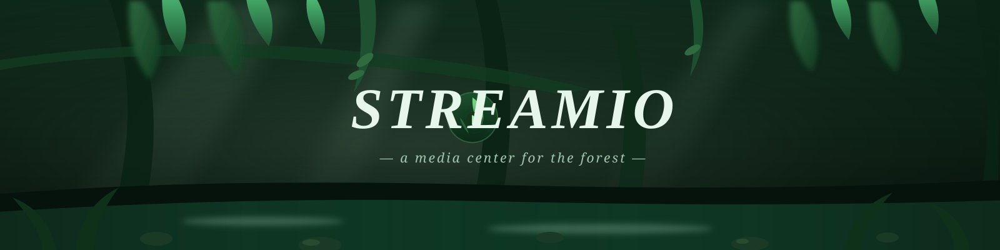
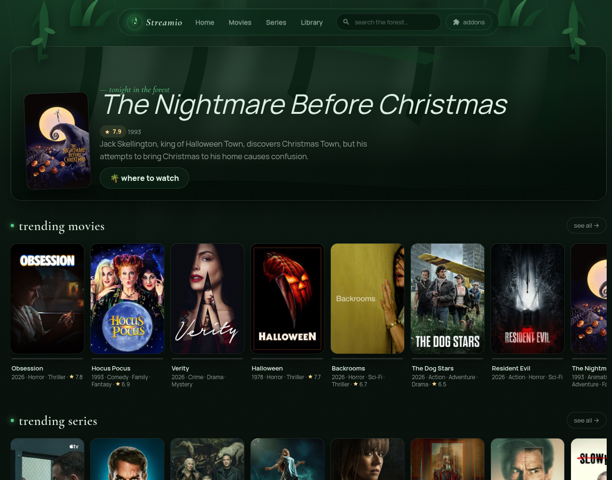

<div align="center">



# 🌿 Streamio

**a humid, forest‑dim media center — movies & series from the community, for the community**

*Plays what the big apps play. Breathes like a rainforest. No account, no gate — just moss, glass and streams.*

</div>

<div align="center">

 -✅-1d5330?labelColor=0b2416)   



</div>

---

Streamio is a **fresh‑forest media center** in the spirit of Stremio: browse catalogs, search,
pick a stream from any community addon you plant, watch in a dim player while a fake jungle
rains gently behind the glass. It speaks the standard **[Stremio addon
protocol](https://github.com/Stremio/stremio-addon-sdk)** — so thousands of existing addons
(catalogs, streams, subtitles) root directly into it.

Everything lives in **plain static files** (HTML/CSS/JS). No build step, no telemetry, no
god mode. Your library & watch‑progress live in your browser's localStorage. Your sources are
the **addons you choose** — Streamio ships with none, like a forest with no roads. 🍄

## ✨ features

- 🌿 **rainforest UI** — floating glass menu with fern foliage **passing over its top edge**, mist rays, animated rain, film‑grain, drifting fireflies, painted vignette
- 🎬 **works day one** — built‑in Cinemeta catalogs & search, playable trailers, series seasons & episodes
- 🎁 **full addon cups** — paste any Stremio addon manifest URL: its catalogs sprout on home, its streams appear on details
- 🕷 **every kind of stream** — direct files, `.m3u8` (HLS), YouTube, **torrents/magnets via WebTorrent** with a swarm watchdog (no more hanging on "connecting…")
- 🌱 **your library** — save with ♡, continue‑watching bar, all in localStorage; library renders as a **map of your grove** (POI bubbles + dotted trails)
- 🎨 **Theme Studio** — 4 presets (rainforest · glade · pine · wildflower), accent picker, rain/rays/grain/fireflies toggles, vignette & motion switches, glow strength, card size, glass blur, serif/sans letters, custom wallpaper (`--wallpaper`/`assets/wall.jpg`)
- 🌅 **hero checkpoint** — glowing ring dial + key/value HUD (story/year/grove/trail) + orb action buttons
- 🌾 **first‑run seeding** — welcome dialog plants Torrentio + Cinemeta manifests in one click (or "later, I'll plant my own")
- 🕯 **zero dependencies to run** — just a static server (python/node, whatever is installed)

## 🌎 install from anywhere

### ▸ the one‑liner (web app, any machine)

```bash
curl -fsSL https://raw.githubusercontent.com/kodix75/streamio/main/install.sh | bash
```

then:

```bash
streamio            # 🦋 starts the server and opens the forest
streamio --port 9000
streamio --stop
streamio --uninstall
```

> needs `python3`/`python`/`node` (almost every machine has one) · run `streamio --update` after new releases 🌱

### ▸ desktop app (AppImage — linux)

```bash
curl -fsSL https://raw.githubusercontent.com/kodix75/streamio/main/install.sh | bash -s -- --appimage
streamio        # launches the AppImage from ~/.local/bin
```
or grab **`Streamio-0.1.0.AppImage`** from [Releases](https://github.com/kodix75/streamio/releases),
`chmod +x` it and double‑click. `.deb` is built alongside for Debian crowd. 🐧

### ▸ build yourself (electron, from source)

```bash
git clone https://github.com/kodix75/streamio && cd streamio/desktop
npm i && npm start          # 🌲 dev window
npm run dist                # 📦 Streamio-0.1.0.AppImage + .deb in out/
```

### ▸ flatpak

The scaffold lives at [`packaging/com.streamio.Streamio.yml`](packaging/com.streamio.Streamio.yml)
with build steps in its header comments — **PRs welcome**, the flatpack-forest needs a gardener. 🪴

<details>
<summary>🕸 <b>using streamio with any static server</b> (nginx, caddy, apache…)</summary>

```bash
git clone https://github.com/kodix75/streamio
cp -r streamio/app /var/www/streamio   #point your server here, done.
```
CORS is open on Cinemeta & all addon hosts — it just works. Restart your server after git pull.
</details>

## 🌺 tour of the interface

| place | what grows there |
| --- | --- |
| 🌿 **floating menu** | glass pill with ferns **overhanging its top edge** — the signature texture element; addon count pill updates on boot |
| 🌫 **home** | glowing ring-dial hero of a random hit tonight, key/value HUD, "continue watching", trending movie & series rails, vine-threaded posters, your addon catalogs |
| 🌲 **groves** | movies / series browsable by genre chips (catalog race fixed — clicks land reliably) |
| 🌊 **streams panel** | every planted addon's offer with quality pills, first row highlighted as "quick trail" |
| 🌱 **addons drawer** | plant manifest URLs, unplant what's dead, see logos & descriptions |
| ♡ **library** | saved posters render as a **grove map** — circular POI bubbles on dotted trails |
| 🌧 **player** | HLS/WebTorrent/YouTube, 45 s swarm watchdog, esc folds the tent, progress saved |
| 🎨 **Theme Studio** | 4 presets + accent picker + rain/rays/grain/fireflies/vignette/motion switches + glow/card-size/glass sliders + serif/sans letters + custom wallpaper |

## 🍄 addons — the roots

Streamio ships with **no sources by default** (no catalogs beyond Cinemeta metadata, no streams).
On first launch a **welcome dialog** offers one click ("🌱 plant the basics") that plants
Torrentio + Cinemeta's own manifests; choose "later, I'll plant my own" to skip. 🍄
Open **addons** in the menu and plant any stremio‑protocol manifest, for example:

| addon (paste into the drawer) | what it adds |
| --- | --- |
| `https://torrentio.strem.fun/manifest.json` | torrent/debrid streams for everything |
| `https://v3-cinemeta.strem.io/manifest.json` | generic cinemeta addon formatting |
| any manifest from [Stremio's addon docs](https://github.com/Stremio/stremio-addon-sdk) | catalogs, subtitles, streams… |

Streamio respects the addon protocol: `/catalog`, `/stream`, `/meta`, extra handling, CORS.
Write your own in 20 minutes with the [addon SDK](https://github.com/Stremio/stremio-addon-sdk). 🕷

## 🗺 structure

```
streamio/
├── app/                        # the whole web app (no build step!)
│   ├── index.html              #   shell — menu, dialogs, routes
│   ├── css/  theme·menu·cards  #   forest glass, canopy, rails
│   ├── js/   main·ui·api·library·player
│   └── assets/                 #   handcrafted SVG art 🎨
├── desktop/                    # electron shell + electron‑builder (AppImage/deb)
├── packaging/                  # flatpak scaffold + manifest
├── install.sh                  # vanilla curl‑installer (web § appimage modes)
├── docs/assets/                # banner art & screenshots
└── LICENSE                     # MIT 🌿
```

**stack** — vanilla ES modules · glassmorphism with hand‑tuned SVG foliage ·
Cinemeta + Stremio addon protocol · hls.js · WebTorrent (CDN‑lazy) · Electron.

## 🌡 troubleshooting

| mist | remedy |
| --- | --- |
| `streamio` says command not found | `export PATH=$PATH:~/.local/bin` (add it to `~/.bashrc`) |
| posters don't load | cinemeta is down or offline; wait or plant your catalogs from addons |
| torrents won't start | try a stream with real peers, or use a debrid addon; webtorrent needs public swarm |
| port busy | `streamio --port 8488` or `streamio --stop` first |

## 💚 thanks & kin

The interface borrows heat from the forest and honesty from these kin:
[raffi](https://github.com/kaleidal/raffi) · [Opal](https://github.com/debpalash/Opal) ·
[source code / inspiration: Stremio Neo](https://www.reddit.com/r/StremioAddons/comments/1pnbp5z/stremio_neo_a_modern_looking_open_source_form_of/) ·
[stremio-addon-sdk](https://github.com/Stremio/stremio-addon-sdk) thanks for the protocol 🍊 ·
Ori and the Blind Forest‑style game HUDs & fantasy‑map infographics for the checkpoint-dial
hero, vine-threaded rails, POI-bubble library map, and firefly ambient (kept in the forest mood) 🌲

## 📄 license

MIT — see [`LICENSE`](LICENSE). Stream responsibly: only plant addons you're allowed to use.

<div align="center">

`🌿 ∙ 🦋 ∙ 🍄 ∙ grown for aidan's dark rainforest wallpaper ∙ 🦔 ∙ 🌱 ∙ 🌿`

</div>
